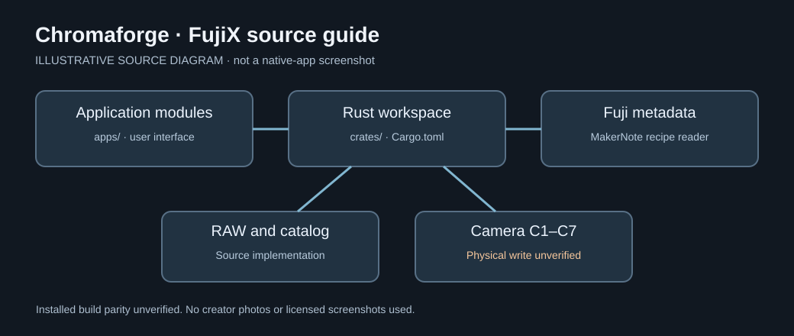

# FujiX source and capability guide

This diagram describes the source in this Git branch. It is a schematic preview and **not a capture of a running application or camera session**.

## Major layers

Chromaforge is a Rust workspace. `apps/` provides application entry points; `crates/` contains the catalog, metadata, image processing, UI, and other reusable features. `Cargo.toml` defines workspace packages and dependencies. `brand.toml` controls user-facing application identity, and `docs/` contains upstream architecture and workflow notes.

The included Fuji-specific metadata reader in `crates/meta/src/fuji.rs` interprets film settings when found in a Fujifilm image's MakerNote; it explicitly cannot reconstruct the camera's complete JPEG rendering or a custom recipe name. The X100VI sensor and lens paths in the raw pipeline are separate from the camera's C-bank configuration. See the existing [architecture guide](architecture.md), [Fuji lens correction notes](fuji-lens-corrections.md), and [source publication status](../FUJIX-PUBLICATION.md).

## Build, verify, and contribute

Install the Rust toolchain and native dependencies described in the root [README](../README.md). From the root, use `cargo xtask run` for a development app and `cargo xtask ci --fast` for the project's standard fast gate, if sufficient system dependencies and disk space are available. A focused metadata test can be run with `cargo test -p lcc-meta fuji` after identifying package availability. Check `cargo metadata --no-deps` when verifying package names and feature resolution.

This isolated branch has **not** been established as a binary match for the currently installed November application. Full graphical QA, a clean native build, and physical camera read/write validation are still required. The local C1–C7 draft assignments are not validated as physical X100VI slot programming. Do not feed the app or browser synthetic payloads and describe them as camera readback.

## Source origins and images

Chromaforge derives from [emmertex/chromaforge](https://github.com/emmertex/chromaforge), specifically commit `b8a1b8b1f96020a2bc1efd3d2e89d46cb42498af` plus FujiX additions. This public source snapshot has a fresh repository root to avoid uploading incomplete Git objects from a shallow checkout; full original source history is linked at upstream. Keep the root MIT [LICENSE](../LICENSE), [NOTICE](../NOTICE), and [asset attribution](../assets/ATTRIBUTION.md); `crates/segment` and `crates/fetch` carry Apache-2.0 exceptions. Existing upstream demo screenshots are retained with their upstream attribution; individual third-party photo reuse permissions should be checked separately. This new schematic is project-authored and contains no private photos or recipe artwork.
